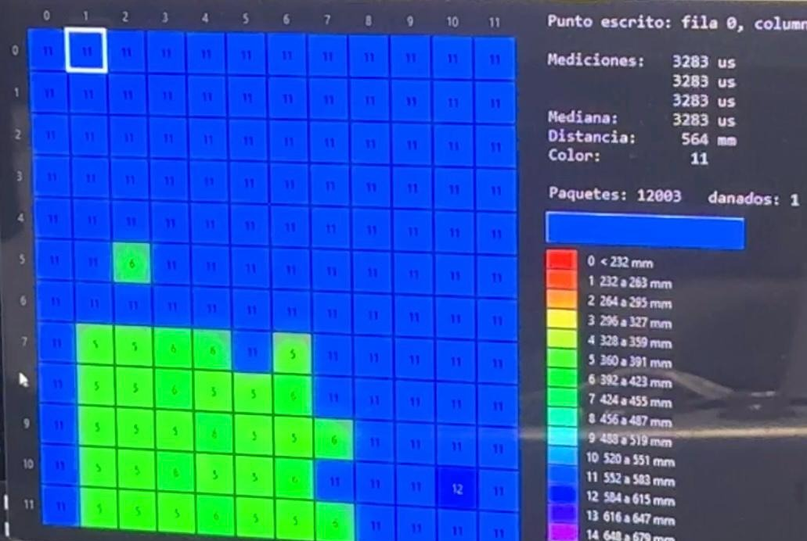

# Escáner de profundidad ultrasónico de 12 × 12 puntos sobre la Tang Nano 9K

Proyecto final de **Electrónica Digital**, Escuela Colombiana de Ingeniería Julio Garavito.

**Autores:** Juan David Garavito Grande y Miguel Angel Guerrero Montenegro.

Un sensor ultrasónico HC-SR04, montado sobre un soporte *pan-tilt* de dos servomotores SG90, recorre una rejilla de 12 × 12 puntos. La FPGA GW1NR-9 de la tarjeta Tang Nano 9K mide la distancia de cada punto, la convierte en uno de 16 colores y la guarda en una memoria interna. Cada punto guardado se envía al computador por el USB de la tarjeta, donde un programa en Python dibuja la imagen de profundidad. Una imagen completa tarda unos 34 s.



---

## Contenido del repositorio

```
.
├── README.md                     este archivo
├── informe/
│   ├── informe_final.pdf         informe en formato IEEE
│   └── latex/                    fuente del informe (para Overleaf)
├── rtl/                          módulos en Verilog
│   ├── por_gen.v                 reset de encendido
│   ├── tick_gen.v                base de tiempo de 1 µs
│   ├── sync_ff.v                 sincronizador de entradas externas
│   ├── debounce.v                antirrebote de los pulsadores
│   ├── grid_walker.v             recorrido en serpentina de la rejilla
│   ├── servo_pwm.v               señales de los servos y pulso frame (20 ms)
│   ├── hcsr04_ctrl.v             control del sensor HC-SR04
│   ├── median3.v                 mediana de tres mediciones
│   ├── echo_to_mm.v              tiempo de eco a milímetros
│   ├── depth_quant.v             distancia a índice de color
│   ├── depth_ram.v               memoria de la imagen (256 × 4 bits)
│   ├── scan_fsm.v                máquina de estados del escaneo
│   ├── uart_tx.v                 transmisor serial UART 8N1
│   ├── mem_monitor.v             lee la memoria y la envía al PC
│   └── lidar_top.v               sistema sin envío al PC (versión de prueba)
├── monitor/
│   ├── lidar_top_monitor.v       MÓDULO SUPERIOR DEL SISTEMA FINAL
│   ├── lidar_top_monitor.cst     pines del sistema final
│   └── ver_memoria.py            programa del PC que dibuja la imagen
├── constraints/lidar_top.cst     pines de lidar_top (versión de prueba)
├── tb/                           un testbench por módulo y del sistema
├── docs/                         diagrama de cada módulo (PDF y SVG)
├── ondas/                        configuraciones de GTKWave
├── simular.sh                    corre los testbenches
└── ver_ondas.sh                  abre las formas de onda en GTKWave
```

---

## 1. Materiales

| Elemento | Detalle |
|---|---|
| Tarjeta | Sipeed Tang Nano 9K (FPGA GW1NR-LV9QN88PC6/I5, oscilador de 27 MHz) |
| Sensor | HC-SR04 (ultrasonido) |
| Servos | 2 × SG90, montados como *pan-tilt* (el sensor va sobre el servo vertical) |
| Fuente | 5 V externa para los servos y el sensor |
| Resistencias | 1 kΩ y 2 kΩ (divisor de Echo) |
| Otros | protoboard, cables, cable USB-C y un computador |

## 2. Conexiones

| Señal | Pin de la Tang Nano 9K | Conexión |
|---|---|---|
| `pwm_pan` | 25 | cable naranja del servo horizontal |
| `pwm_tilt` | 26 | cable naranja del servo vertical |
| `trig` | 27 | Trig del HC-SR04 (directo) |
| `echo` | 28 | Echo del HC-SR04 **a través del divisor** |
| `tx_pc` | 17 | interno: va al chip USB de la tarjeta, no se cablea |
| `btn_s1`, `btn_s2` | 4, 3 | pulsadores de la tarjeta, no se cablean |
| `led[5:0]` | 10 a 16 | LEDs de la tarjeta, no se cablean |

**Alimentación**
- Servos y sensor: rojo/VCC a los 5 V de la fuente; marrón/GND a la tierra.
- **Un pin GND de la Tang Nano 9K debe ir a la tierra de la fuente.** Sin tierra común, ni los servos ni el sensor entienden las señales.
- La tarjeta se alimenta por el cable USB.

**Divisor de Echo (obligatorio).** El HC-SR04 entrega Echo a 5 V y la FPGA trabaja a 3,3 V:
```
Echo ──[1 kΩ]──┬──── pin 28
               │
             [2 kΩ]
               │
              GND            5 V × 2/(1+2) = 3,3 V
```

## 3. Simulación (opcional, Ubuntu)

Se necesita Icarus Verilog (y GTKWave para ver las ondas):
```bash
sudo apt install iverilog gtkwave
chmod +x simular.sh ver_ondas.sh      # si se perdieron los permisos al descargar
```

Correr todas las pruebas (tarda unos minutos):
```bash
./simular.sh
```
Al final debe aparecer `PRUEBA EXITOSA` para los 15 testbenches. El detalle queda en `sim/resultados.txt`.

Correr una sola prueba y ver sus ondas:
```bash
./simular.sh servo_pwm
./ver_ondas.sh servo_pwm
```

Simular el sistema completo con el envío al PC y revisar lo que se recibió:
```bash
./simular.sh monitor
python3 monitor/ver_memoria.py --archivo sim/monitor_uart.txt
```

## 4. Síntesis y programación (Gowin EDA)

1. Instalar **Gowin EDA** (la versión Education es gratuita) desde la página de GOWIN Semiconductor.
2. Crear un proyecto: *File > New > FPGA Design Project*.
   - Dispositivo: **GW1NR-LV9QN88PC6/I5** (serie GW1NR, dispositivo GW1NR-9C, encapsulado QFN88P, velocidad C6/I5).
3. Agregar los archivos (*clic derecho en el proyecto > Add Files*):
   - todos los `.v` de `rtl/` **excepto `lidar_top.v`**;
   - `monitor/lidar_top_monitor.v`;
   - `monitor/lidar_top_monitor.cst`.
4. En *Project > Configuration > Synthesize*, poner **Top Module/Entity = `lidar_top_monitor`**.
5. Si Place & Route se queja de un pin de "doble propósito", marcar en *Project > Configuration > Dual-Purpose Pin* la opción de usarlo como I/O normal.
6. Dar **Run All** y luego programar la tarjeta con **Gowin Programmer** (*SRAM Program* para una prueba, o *Embedded Flash* para que el diseño quede guardado al apagar).

También se puede programar desde Linux con openFPGALoader:
```bash
openFPGALoader -b tangnano9k impl/pnr/<proyecto>.fs
```

## 5. Programa del computador

Se necesita Python 3 con pyserial (tkinter ya viene con Python en Windows):
```bash
pip install pyserial
```

1. Probar la ventana sin la tarjeta:
   ```bash
   python monitor/ver_memoria.py --demo
   ```
2. Con la tarjeta conectada, ver los puertos. La tarjeta aparece como **dos** puertos COM: uno es JTAG y el otro el serial, normalmente el de número mayor.
   ```bash
   python monitor/ver_memoria.py --puertos
   ```
3. Abrir la ventana con el puerto de la tarjeta (cerrar antes Gowin Programmer, que puede ocupar el puerto):
   ```bash
   python monitor/ver_memoria.py COM11        # Windows
   python3 monitor/ver_memoria.py /dev/ttyUSB1  # Linux
   ```
   Teclas: `h` = espejo horizontal, `v` = espejo vertical.

## 6. Uso

1. Conectar todo, encender la fuente de 5 V y conectar el USB.
2. Esperar a que se encienda el **LED 1** (arranque terminado).
3. Presionar **S1** para iniciar el barrido. El LED 0 se enciende y la rejilla se va pintando en el computador, un punto cada unos 0,24 s.
4. **S1** otra vez detiene el barrido. **S2** reinicia el barrido al punto (0, 0).

Los LEDs 2 a 5 muestran en binario el color de la última medición, así que sirven para probar el sensor sin el computador.

**Paleta:** del rojo (color 0, menos de 232 mm) al morado (color 14, de 648 a 679 mm), en pasos de 32 mm a partir de 200 mm. El color 15 (negro) es el fondo: 680 mm o más, o sin eco.

## 7. Parámetros ajustables

Se cambian en `monitor/lidar_top_monitor.v`:

| Parámetro | Valor | Qué controla |
|---|---|---|
| `N` | 4 | frames de 20 ms entre disparos (espera de 60 a 80 ms) |
| `RET` | 10 | frames de espera para que los servos regresen a (0, 0) |
| `BASE_PAN`, `BASE_TILT` | 1280 | ancho de pulso (µs) del punto 0 de cada servo |
| `D_NEAR` | 200 | distancia (mm) donde empieza la escala de colores |

En `rtl/hcsr04_ctrl.v`, `RISE_MAX = 5000` µs es la espera máxima a que suba Echo. El HC-SR04 usado tarda unos 2,2 ms en responder; si se usa uno que tarde más, hay que subirlo.

## 8. Documentación

- `informe/informe_final.pdf`: informe del proyecto (formato IEEE).
- `docs/<módulo>/`: diagrama de cada módulo en PDF y SVG.
- Cada archivo de `rtl/` empieza con un comentario que explica qué hace el módulo, su interfaz, sus decisiones de diseño y la correspondencia con su diagrama.
- Cada archivo de `tb/` empieza con la lista de casos que prueba.
